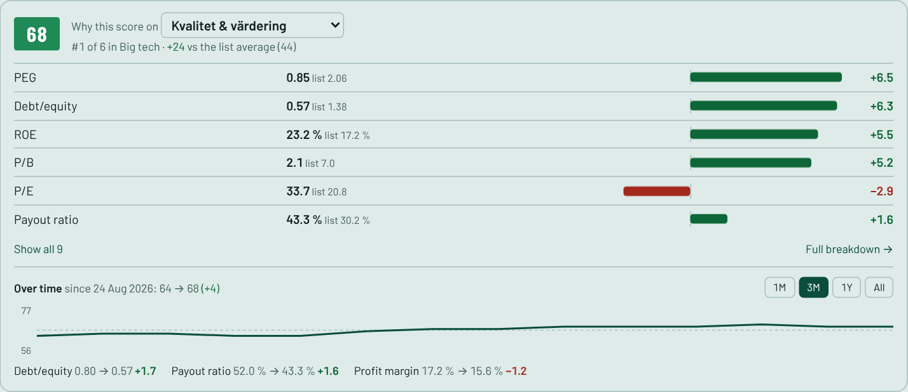

# Market Screener

[](https://github.com/godvig/market-screener/actions/workflows/ci.yml) [](LICENSE)

A stock screener built around **your own scorecards**. Rank a watchlist by what you care about (return on capital, debt, dividends, growth), see why each stock scores what it does compared with the rest of the list, and follow how that score moves over time. It started as a set of Excel scoring sheets; prices and key figures come from free APIs or your own Börsdata/CSV export, and everything stays on your machine.


## Live demo

**[screener.godvig.com](https://screener.godvig.com/)**: made-up prices, runs entirely in your browser, no account.

| Ranked by a scorecard | Why this score | Build your own |
| --- | --- | --- |
|  |  |  |

## Quick start

You need [Node.js](https://nodejs.org) 20 or newer. Then:

1. Download the repo (**Code → Download ZIP** and unpack it, or `git clone`).
2. Run the start file in the folder: `./start.sh` on Linux and macOS, `start.bat` on Windows (double-click works too).

The first run installs the dependencies and builds the app, which takes a minute. After that it starts the server and opens the app in your browser. If port 8787 is busy it takes the next free one, and starting it twice just opens the one already running. Your lists, scorecards and score history are kept in `data/` in the folder.

On Linux, `./start.sh --shortcut` adds Market Screener to the application menu. On SteamOS, install Node without admin rights via [nvm](https://github.com/nvm-sh/nvm); `start.sh` prints the two commands if Node is missing.

### Development

```bash
npm install
cp .env.example .env      # PROVIDER=yahoo works without a key
npm run dev               # web on http://localhost:5173, API on :8787
```

Run `npm run dev:mock` for offline demo data. To use other ports: `PORT=8790 npm run dev -- --port 5180`.

### Static demo

`VITE_DEMO=1 npm run build` builds a version that needs no server: prices and key figures come from the same deterministic fake data as `PROVIDER=mock`, computed in the browser, and lists are saved in `localStorage`. Every push to `main` publishes it to GitHub Pages via `.github/workflows/demo.yml`.

## Features

- **Your own scorecards.** Nine presets from the original spreadsheets, or build your own: change criteria, thresholds, points and weights and watch the list re-rank live. Share a scorecard as a JSON file
- **Coverage at a glance.** A thin bar under a score shows how much of the scorecard had data; hover it for what is missing. Full coverage shows no bar
- **Trebles.** Three core scorecards (*Sundhet*, *Kvalitet & värdering* and *Utdelning*) are shown by default. A stock that is green on all three, each with enough data behind it (without *Utdelning* for a company that pays no dividend), is marked as a *treble* and can be filtered on: a shortlist for a closer look. The other presets are a click away in the sidebar. The stock page keeps a treble history: when it became one and how the price has moved since
- **Why this score.** Every score is broken down per criterion and compared with the rest of the list: what lifts a stock above a typical one and what pulls it down
- **Score history.** Key figures are saved over time, so any scorecard, even one you built today, can be scored back in time
- **Bring your own data.** Free APIs (Yahoo, Finnhub, FMP) or a CSV/Excel export, for example from Börsdata, with columns recognised in Swedish and English
- **A proper table.** Sortable and filterable, with traffic lights, a column picker, data coverage per column and prices in both the listing currency and SEK
- **Stock page.** Candlestick chart with SMA50/SMA200, and every key figure in folding groups that mark the ones the score uses
- **Keyboard shortcuts.** R rename, C copy, E export, I import and D delete a list
- **Private by design.** Lists, notes and imported figures stay on your machine; API keys never reach the browser
- **Works on your phone,** in light and dark

Everything in detail, including how each metric is calculated: **[the guide](docs/GUIDE.md)**.

## Architecture

A React client and a small Express API in one TypeScript repo. The API proxies the data providers, caches responses (memory and disk) to stay inside free-tier limits and stores lists in `data/store.json`. All analysis runs in `shared/`, used by both sides. The static demo builds the client alone, with the mock provider computed in the browser.

### Project layout

```
server/            Express API (proxy, cache, providers, FX, storage)
  providers/       yahoo · borsdata · finnhub · fmp · mock adapters
shared/            Types + analysis functions (used by server and client)
  import*.ts       file import: reading, synonyms, matching, merge rules
docs/examples/     made-up sample export for the import
src/               React client (Vite, TanStack Table, lightweight-charts)
  columns.tsx      every table column in one registry
```

To add a data source, implement `MarketProvider` in `server/providers/` and register it in `server/providers/index.ts`.

## Tests and scripts

| Command | What it does |
|---|---|
| `npm run dev` | API + Vite dev server with hot reload |
| `npm run dev:mock` | Same, with offline mock data |
| `npm test` | Unit tests (analysis, scoring, import, store) |
| `npm run typecheck` | TypeScript check |
| `npm run lint` | Lint with oxlint |
| `npm start` | Same as `start.sh`: build if needed, serve everything on one port, open the browser |

CI runs lint, typecheck, tests and both builds on every push and pull request.

## Roadmap

- [x] Currency conversion to SEK next to the original values
- [ ] Compare view: the same metric from several providers side by side
- [x] Multiple named watchlists with JSON export/import
- [ ] CSV export of the table
- [ ] Compare view: normalised performance of several tickers on one chart
- [ ] Screener: filter rules like "RSI < 30 and above SMA200"
- [ ] Fundamentals tab (revenue, margins, cash flow) from FMP
- [x] Public demo running on made-up data (screener.godvig.com)

## License

[MIT](LICENSE) © Adam Englund. The license covers the code only; market data is subject to each provider's own terms (see [Data and terms of use](docs/GUIDE.md#data-and-terms-of-use)).

Built by [Adam Englund](https://adamenglund.eu), with AI assistance (Claude) for much of the code. The scoring model, the architecture and the product decisions are mine.
