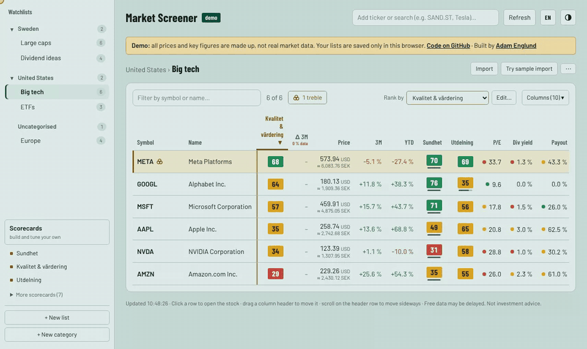
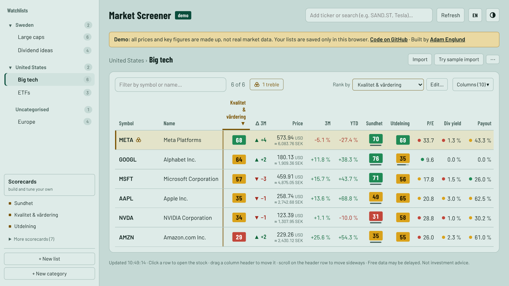
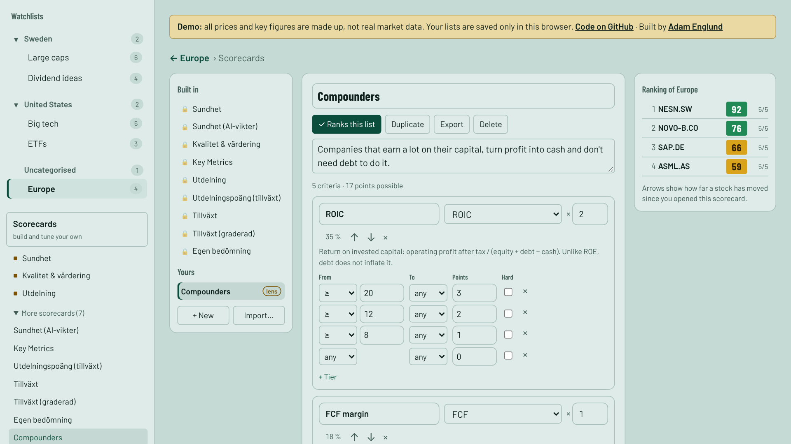

# Market Screener

[](https://github.com/godvig/market-screener/actions/workflows/ci.yml) [](LICENSE)

A stock screener built around **your own scorecards**. Rank a watchlist by what you care about (return on capital, debt, dividends, growth), see why each stock scores what it does compared with the rest of the list, and follow how that score moves over time. It started as a set of Excel scoring sheets; prices and key figures come from free APIs or your own Börsdata/CSV export, and everything stays on your machine.



## Live demo

**[screener.godvig.com](https://screener.godvig.com/)**: made-up prices, runs entirely in your browser, no account. Visits to the demo are counted anonymously with [GoatCounter](https://www.goatcounter.com/) (no cookies; one request with the path, referrer and screen width, see [`src/counter.ts`](src/counter.ts)). A local install sends nothing.

| Ranked by a scorecard | Why this score | Build your own |
| --- | --- | --- |
|  |  |  |

## Quick start

```bash
npm install
cp .env.example .env      # PROVIDER=yahoo works without a key
npm run dev               # web on http://localhost:5173, API on :8787
```

Run `npm run dev:mock` for offline demo data.

### Static demo

`VITE_DEMO=1 npm run build` builds a version that needs no server: prices and key figures come from the same deterministic fake data as `PROVIDER=mock`, computed in the browser, and lists are saved in `localStorage`. Every push to `main` publishes it to GitHub Pages via `.github/workflows/demo.yml`.

## Features

- **Your own scorecards.** Nine presets from the original spreadsheets, or build your own: change criteria, thresholds, points and weights and watch the list re-rank live. Share a scorecard as a JSON file
- **Why this score.** Every score is broken down per criterion and compared with the rest of the list: what lifts a stock above a typical one and what pulls it down
- **Score history.** Key figures are saved over time, so any scorecard, even one you built today, can be scored back in time
- **Bring your own data.** Free APIs (Yahoo, Finnhub, FMP) or a CSV/Excel export, for example from Börsdata, with columns recognised in Swedish and English
- **A proper table.** Sortable and filterable, with traffic lights, a column picker, data coverage per column and prices in both the listing currency and SEK
- **Stock page.** Candlestick chart with SMA50/SMA200 and every key figure
- **Private by design.** Lists, notes and imported figures stay on your machine; API keys never reach the browser
- **Works on your phone,** in light and dark

Everything in detail, including how each metric is calculated: **[the guide](docs/GUIDE.md)**.

## Architecture

A React client and a small Express API in one TypeScript repo. The API proxies the data providers, caches responses (memory and disk) to stay inside free-tier limits and stores lists in `data/store.json`. All analysis runs in `shared/`, used by both sides. The static demo builds the client alone, with the mock provider computed in the browser.

### Project layout

```
server/            Express API (proxy, cache, providers, FX, storage)
  providers/       yahoo · borsdata · finnhub · fmp · mock adapters
shared/            Types + analysis functions (used by server and client)
  import*.ts       file import: reading, synonyms, matching, merge rules
docs/examples/     made-up sample export for the import
src/               React client (Vite, TanStack Table, lightweight-charts)
  columns.tsx      every table column in one registry
  counter.ts       anonymous visit counting, for the hosted demo only
```

To add a data source, implement `MarketProvider` in `server/providers/` and register it in `server/providers/index.ts`.

## Tests and scripts

| Command | What it does |
|---|---|
| `npm run dev` | API + Vite dev server with hot reload |
| `npm run dev:mock` | Same, with offline mock data |
| `npm test` | Unit tests (analysis, scoring, import, store) |
| `npm run typecheck` | TypeScript check |
| `npm run lint` | Lint with oxlint |
| `npm run build && npm start` | Production build served by the API on :8787 |

CI runs lint, typecheck, tests and both builds on every push and pull request.

## Roadmap

- [x] Currency conversion to SEK next to the original values
- [ ] Compare view: the same metric from several providers side by side
- [x] Multiple named watchlists with JSON export/import
- [ ] CSV export of the table
- [ ] Compare view: normalised performance of several tickers on one chart
- [ ] Screener: filter rules like "RSI < 30 and above SMA200"
- [ ] Fundamentals tab (revenue, margins, cash flow) from FMP
- [x] Public demo running on made-up data (screener.godvig.com)

## License

[MIT](LICENSE) © Adam Englund. The license covers the code only; market data is subject to each provider's own terms (see [Data and terms of use](docs/GUIDE.md#data-and-terms-of-use)).

Built by [Adam Englund](https://adamenglund.eu).
